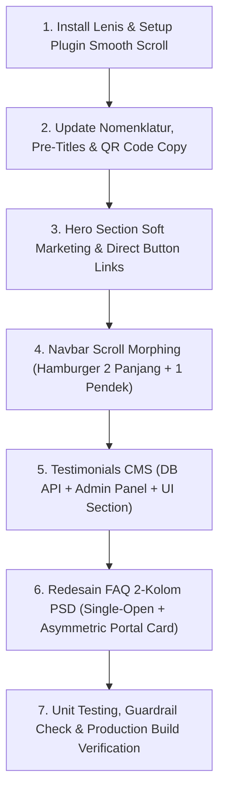

# Rencana Implementasi: Redesain FAQ PSD, Testimoni Klien CMS, Navbar Morphing DTP, Copywriting Hero, & Smooth Scroll Lenis

## Ringkasan Eksekutif
Dokumen rencana ini merinci langkah-langkah penyesuaian desain, struktur navigasi, konten teknis, dan interaktivitas website **School Smart Digital (SSD)** berdasarkan instruksi terbaru pengguna serta referensi desain visual dari **Digital Teknologi Perkasa (DTP)** dan **Pesantren Smart Digital (PSD)**.

---

## 1. Breakdown Pekerjaan & Penyesuaian

### A. Pembersihan Pre-Title (Hapus Nomor Urut & Em-Dash)
- **Kondisi Saat Ini**: Masih terdapat nomor urut dan m-dash pada badge section (misal: `02 — OPERASIONAL SEKOLAH`, `03 — KATALOG LENGKAP`, `04 — BUKTI KETERHUBUNGAN`, `05 — SOROTAN MODUL`, `06 — MODUL OPERASIONAL`, `07 — TINGKAT OTORISASI`, `08 — FONDASI MULTI-UNIT`, `09 — KEAMANAN & PRIVASI`, `10 — PERBANDINGAN JUJUR`).
- **Tindakan**:
  - Hapus angka `02 —`, `03 —`, dst., ganti menjadi badge kategori bersih tanpa prefix numerik:
    - `OPERASIONAL SEKOLAH`
    - `KATALOG LENGKAP · 12 APLIKASI SATU PLATFORM`
    - `BUKTI KETERHUBUNGAN DATA · ALUR HARIAN`
    - `SOROTAN MODUL`
    - `MODUL OPERASIONAL`
    - `TINGKAT OTORISASI`
    - `FONDASI MULTI-UNIT`
    - `KEAMANAN & PRIVASI`
    - `PERBANDINGAN JUJUR`
  - Periksa seluruh file komponen: [ProblemList.vue](file:///d:/All%20Project%20Website/Web%20School%20Smart%20Digital/apps/web/app/components/ProblemList.vue), [EcosystemSelector.vue](file:///d:/All%20Project%20Website/Web%20School%20Smart%20Digital/apps/web/app/components/EcosystemSelector.vue), [FlowTimeline.vue](file:///d:/All%20Project%20Website/Web%20School%20Smart%20Digital/apps/web/app/components/FlowTimeline.vue), [SpotlightTabs.vue](file:///d:/All%20Project%20Website/Web%20School%20Smart%20Digital/apps/web/app/components/SpotlightTabs.vue), [ModuleGrid.vue](file:///d:/All%20Project%20Website/Web%20School%20Smart%20Digital/apps/web/app/components/ModuleGrid.vue), [RoleLadder.vue](file:///d:/All%20Project%20Website/Web%20School%20Smart%20Digital/apps/web/app/components/RoleLadder.vue), [UnitDiagram.vue](file:///d:/All%20Project%20Website/Web%20School%20Smart%20Digital/apps/web/app/components/UnitDiagram.vue), [TrustPillars.vue](file:///d:/All%20Project%20Website/Web%20School%20Smart%20Digital/apps/web/app/components/TrustPillars.vue), dan [HonestTable.vue](file:///d:/All%20Project%20Website/Web%20School%20Smart%20Digital/apps/web/app/components/HonestTable.vue).

---

### B. Koreksi Direct Section Button pada Box "1 Data Lintas Unit & Peran"
- **Kondisi Saat Ini**: Di [HeroPortal.vue](file:///d:/All%20Project%20Website/Web%20School%20Smart%20Digital/apps/web/app/components/HeroPortal.vue#L275-L276), tombol `[Jadwalkan Demo]` mengarah ke `#demo` dan `[Lihat 12 Aplikasi ↓]` mengarah ke `#ekosistem`. Pada struktur multi-halaman saat ini, tautan hash lokal tersebut tidak langsung berpindah ke halaman tujuan.
- **Tindakan**:
  - Ganti anchor menjadi NuxtLink:
    - Tombol primer: `Jadwalkan Konsultasi / Demo` -> `/kontak`
    - Tombol sekunder: `Lihat 12 Aplikasi →` -> `/fitur`

---

### C. Nomenklatur Multi-Unit Lengkap (SD · SMP · SMA · Ekstrakurikuler · Asrama / Boarding School)
- **Ketentuan Baru**:
  - Tambahkan jenjang **SMA** secara eksplisit.
  - Ubah **TPQ** menjadi **Ekstrakurikuler** (mewakili kegiatan bakat, minat, klub olahraga/seni, kepramukaan & keagamaan).
  - Ubah kata **Pondok** menjadi **Asrama / Boarding School** (mewakili fasilitas hunian, kamar santri, kedisiplinan malam, dan izin pesiar).
- **Tindakan**:
  - Terapkan di [HeroPortal.vue](file:///d:/All%20Project%20Website/Web%20School%20Smart%20Digital/apps/web/app/components/HeroPortal.vue): `Multi-unit (SD · SMP · SMA · Ekstrakurikuler · Asrama / Boarding School)`.
  - Update [UnitDiagram.vue](file:///d:/All%20Project%20Website/Web%20School%20Smart%20Digital/apps/web/app/components/UnitDiagram.vue): tambahkan card jenjang SMA, perbarui card Ekstrakurikuler dan Asrama/Boarding School dengan total 5 unit terintegrasi satu data yayasan.
  - Perbarui dropdown dan field pada [DemoForm.vue](file:///d:/All%20Project%20Website/Web%20School%20Smart%20Digital/apps/web/app/components/DemoForm.vue) serta dokumen [content/index.ts](file:///d:/All%20Project%20Website/Web%20School%20Smart%20Digital/packages/shared/src/content/index.ts).

---

### D. Koreksi Teknologi Kartu (Kartu Siswa Pintar Berbasis QR Code, BUKAN RFID)
- **Ketentuan Baru**:
  - Sistem SSD menggunakan **Kartu Pelajar Pintar Berbasis QR Code / Barcode Scanner Cepat** (seperti implementasi Smart Turnstile pada Pesantren Smart Digital), **BUKAN RFID**.
  - Manfaat: Efisiensi biaya cetak kartu, kemudahan integrasi dengan scanner optik 2D di gerbang/turnstile, pencegahan kartu terduplikasi melalui dynamic/encrypted QR code pada aplikasi wali santri.
- **Tindakan**:
  - Hapus dan ubah seluruh penyebutan kata `RFID` pada [fitur.vue](file:///d:/All%20Project%20Website/Web%20School%20Smart%20Digital/apps/web/app/pages/fitur.vue), [index.vue](file:///d:/All%20Project%20Website/Web%20School%20Smart%20Digital/apps/web/app/pages/index.vue), [kontak.vue](file:///d:/All%20Project%20Website/Web%20School%20Smart%20Digital/apps/web/app/pages/kontak.vue), [HeroPortal.vue](file:///d:/All%20Project%20Website/Web%20School%20Smart%20Digital/apps/web/app/components/HeroPortal.vue), dan [privacy-policy.vue](file:///d:/All%20Project%20Website/Web%20School%20Smart%20Digital/apps/web/app/pages/privacy-policy.vue).
  - Ganti dengan: *"Smart Turnstile & Gate berbasis Kartu QR Code Scanner"* dan *"Kartu Pelajar Pintar QR Code"*.

---

### E. Redesain Section FAQ Mengadopsi Layout Pesantren Smart Digital
- **Referensi Visual**: Lampiran gambar FAQ PSD (`media_1792950763567_6fa82500.png`) & geometri portal (`media_1792951172844_3b060855.png`).
- **Spesifikasi Teknis**:
  1. **Struktur 2 Kolom Responsif**:
     - Kolom Kiri: Accordion FAQ daftar tanya-jawab.
     - Kolom Kanan: Card visual portal showcase.
  2. **Interaktivitas Accordion**:
     - *Single-open state*: ketika pertanyaan kedua diklik, pertanyaan pertama otomatis menutup (`openIndex = openIndex === index ? null : index`).
     - Tampilan card FAQ: warna putih, border halus, bayangan lembut, chevron panah yang berotasi mulus saat terbuka, dan indikator aktif bernuansa Navy & Cyan.
  3. **Card Visual Showcase Portal**:
     - Mengadopsi bentuk lengkung sudut khas portal SSD (top-left lengkung dramatis `rounded-tl-[110px] rounded-2xl` sesuai referensi viewport).
     - Di dalamnya memiliki lapisan gradasi visual Navy `#0C3161` & Cyan `#01A8CF`.
     - Dirancang dan disiapkan agar ketika nanti dimasukkan foto talent berlatar transparan (guru/siswa), tampilannya langsung menyatu sempurna.
     - Dilengkapi badge lampu ide cerdas (`💡` floating badge) di pojok kanan atas seperti referensi PSD.
     - Dilengkapi floating info pill di bagian bawah: *"Punya pertanyaan khusus? Tim konsultan SSD siap membantu via konsultasi interaktif"*.
  4. **Palet Warna**: Menggunakan identitas SSD murni (Navy `#0C3161`, Cyan `#01A8CF`, Slate icy `#F4F8FA`).

---

### F. Penambahan Section Testimoni Klien & Integrasi CMS Admin Panel
- **Tujuan**: Membangun kepercayaan calon mitra sekolah dengan menampilkan testimoni autentik dari kepala sekolah, ketua yayasan, dan operator.
- **Penempatan**: Diletakkan tepat **sebelum** section FAQ pada halaman [index.vue](file:///d:/All%20Project%20Website/Web%20School%20Smart%20Digital/apps/web/app/pages/index.vue).
- **Komponen Publik**: Buat komponen baru `apps/web/app/components/TestimonialSection.vue`.
  - Menampilkan grid/carousel kartu testimoni elegan:
    - Bintang rating (1–5)
    - Kutipan testimoni
    - Foto avatar kepala sekolah / pengurus
    - Nama, jabatan, dan nama sekolah mitra (misal: *Kepala SMP IT Nurul Fikri*, *Ketua Yayasan Pendidikan Darul Hikmah*, *Wakasek Kesiswaan SMA Al-Azhar*)
    - Badge *Terverifikasi SSD*
- **Integrasi Admin Panel (`/admin/testimonials`)**:
  - Halaman [apps/web/app/pages/admin/testimonials.vue](file:///d:/All%20Project%20Website/Web%20School%20Smart%20Digital/apps/web/app/pages/admin/testimonials.vue) diperbarui menjadi panel CRUD penuh (seperti di web DTP):
    - Daftar testimoni klien dengan filter status & search.
    - Modal Tambah & Edit Testimoni (Nama Klien, Jabatan/Sekolah Mitra, Isi Testimoni, Rating Bintang, URL Foto/Avatar, Status Publikasi).
    - Modal konfirmasi Hapus testimoni.
  - Server API Endpoint:
    - `GET /api/testimonials`: Mengambil data testimoni yang dipublikasikan untuk halaman publik.
    - `GET /api/admin/testimonials`: Mengambil seluruh testimoni untuk tabel admin.
    - `POST /api/admin/testimonials`: Tambah testimoni baru.
    - `PUT /api/admin/testimonials/[id]`: Update data testimoni.
    - `DELETE /api/admin/testimonials/[id]`: Hapus testimoni.
  - Database: Memanfaatkan tabel `testimonials` yang telah didefinisikan di schema Drizzle ORM Neon.

---

### G. Transformasi Navigasi Menu ala DTP (Scroll Morphing ke Hamburger Navy 2+1 Garis)
- **Referensi Visual**: Web DTP (`media_1792952754609_fd1213dd.png` dan implementasi [Navbar.vue di DTP](file:///d:/All%20Project%20Website/Digital%20Teknologi%20Perkasa%20Official%20Website-Nuxt/app/components/Navbar.vue)).
- **Mekanisme**:
  1. **Kondisi Normal (Di Puncak Halaman / Scroll < 80px)**:
     - Header penuh tampil dengan logo SSD asli, link menu lengkap (Beranda, Fitur, Galeri, Berita, Tentang Kami, Hubungi Kami), dan tombol CTA "Jadwalkan Konsultasi".
  2. **Kondisi Scroll (Scroll >= 80px)**:
     - Header penuh memudar/menyusut secara halus (`opacity: 0, pointer-events: none`).
     - Muncul **Floating Hamburger Pill** di kanan atas dengan latar Navy `#0C3161` atau glassy pill dengan border elegan.
     - **Signature Hamburger Icon**: 3 garis horizontal:
       - Garis 1 (atas): panjang (lebar 100%)
       - Garis 2 (tengah): panjang (lebar 100%)
       - Garis 3 (bawah): lebih pendek (lebar 60-65%)
       - Berwarna kontras dan memiliki teks pendamping "Menu" yang elegan.
  3. **Interaktivitas Klik Hamburger**:
     - Membuka drawer panel overlay modal penuh/side-drawer dengan animasi slide-in halus (`cubic-bezier(0.16, 1, 0.3, 1)`).
     - Menampilkan header drawer dengan logo SSD, navigasi menu lengkap beranimasi stagger, tombol CTA langsung, serta informasi kontak/sosial media SSD di bagian bawah drawer.
     - Icon bertransformasi menjadi 'X' (Tutup).

---

### H. Modifikasi Main Hero (Pre-Portal Soft Marketing & Jargon ala DTP)
- **Referensi Visual**: Hero DTP (`media_1792952754609_fd1213dd.png`).
- **Struktur Konten Hero Baru**:
  1. **Top Badge**: `✦ PLATFORM EKOSISTEM DIGITAL SEKOLAH TERPADU`
  2. **Headline Persuasif**:
     - Typografi tebal berwibawa: **"Mewujudkan Transformasi Digital Sekolah & Madrasah Modern"** dengan highlight warna Cyan dan Navy.
  3. **Soft Marketing Copy**:
     - *"Kelola seluruh operasional akademik, keuangan SPP terpadu, presensi smart turnstile QR Code, manajemen asrama/boarding school, hingga komunikasi wali santri dalam satu platform cerdas tanpa data terisolasi."*
  4. **Dual CTA Action Buttons**:
     - Tombol 1 (Primary Cyan/Navy): **"Konsultasikan Kebutuhan Anda"** (`/kontak`)
     - Tombol 2 (Secondary Outline/Glass): **"Lihat 12 Aplikasi Terpadu"** (`/fitur`)
  5. **Floating Benefit Pills / Jargon Trust**:
     - `✓ 1 Akun Terpadu untuk Yayasan, Kepala Sekolah, Guru & Orang Tua`
     - `✓ Real-time Sinkronisasi Tanpa Server Lokal yang Rumit`
  6. **Interactive Portal Integration**:
     - Objek portal 3D SSD dengan sayap logo asli Navy di belakang teks knockout "SCHOOL SMART DIGITAL" serta preview login SSD ditempatkan secara harmonis di panggung hero, dan siap dibuka saat pengguna menggulir halaman (*scroll-driven portal expansion*).

---

### I. Pemasangan & Integrasi Smooth Scrolling (Lenis)
- **Tujuan**: Memberikan pengalaman navigasi dan scrolling yang ultra-smooth, premium, dan konsisten di seluruh browser modern.
- **Implementasi**:
  1. Install dependensi `lenis` di `apps/web` (`pnpm --filter web add lenis`).
  2. Buat plugin Nuxt client-only: `apps/web/app/plugins/lenis.client.ts`.
  3. Konfigurasi `new Lenis({ duration: 1.2, easing: (t) => Math.min(1, 1.001 - Math.pow(2, -10 * t)), orientation: 'vertical', smoothWheel: true })`.
  4. Sambungkan ke RAF (requestAnimationFrame).
  5. **Proteksi Khusus Admin Panel**: Deteksi rute `/admin/*` — secara otomatis `lenis.stop()` saat berada di area dashboard admin agar interaksi form modal, tabel panjang, dan scrolling dropdown admin tetap beroperasi native tanpa lag atau benturan event.

---

## 2. Urutan Pengerjaan & Rencana Verifikasi

### Rencana Pengujian:
1. **Pemeriksaan Pre-Title & Nomenklatur**:
   - Memastikan tidak ada lagi awalan `02 —`, `03 —`, dsb.
   - Memastikan teks kartu selalu merujuk ke *Kartu QR Code*, bukan *RFID*.
   - Memastikan jenjang SMA, Ekstrakurikuler, dan Asrama/Boarding School tertera jelas di diagram dan form.
2. **Uji Navigasi Navbar**:
   - Scroll dari posisi `0` ke `200px`: navbar penuh menyusut, floating hamburger navy muncul.
   - Klik hamburger: drawer terbuka mulus, klik link berpindah halaman dan drawer menutup.
3. **Uji FAQ**:
   - Klik item FAQ 1: jawaban terbuka.
   - Klik item FAQ 2: item FAQ 1 otomatis menutup, FAQ 2 terbuka.
   - Periksa responsivitas card portal di sisi kanan.
4. **Uji Testimoni CMS**:
   - Buka `/admin/testimonials`: tambah testimoni baru, edit rating, dan verifikasi muncul di halaman publik `/` sebelum FAQ.
5. **Uji Smooth Scroll Lenis**:
   - Pengguliran halaman depan halus.
   - Pengguliran di area `/admin` berjalan normal tanpa konflik.
6. **Automated Verification**:
   - `pnpm db:check`
   - `node scripts/guardrail-check.mjs`
   - `node tests/runner.mjs`
   - `pnpm --filter web build`

---

